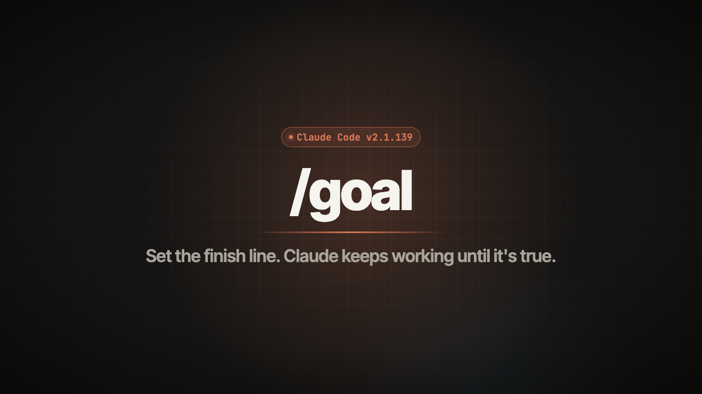
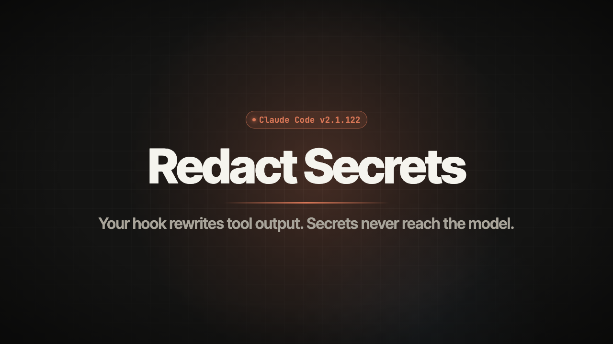

<!-- Generated by showcase/docs-gen. -->
# Feature films

Each film is recorded from a real `claude` session and rendered by the [Feature Showcase Pipeline](../../showcase/README.md).
Click a poster for the page: how to enable it, how to try it, and a transcript.

<table>
<tr><td align="center" valign="top"><a href="goal-until-green.md"> <b>/goal</b></a> v2.1.139 · commands Set the finish line. Claude keeps working until it's true.</td><td align="center" valign="top"><a href="redact-tool-output.md"> <b>Redact Secrets</b></a> v2.1.122 · hooks Your hook rewrites tool output. Secrets never reach the model.</td></tr>
</table>
