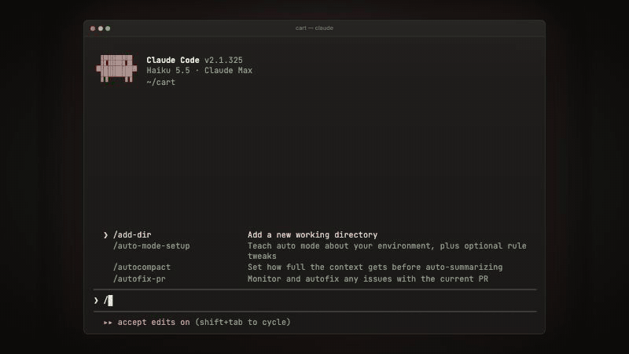

<!-- Generated by showcase/docs-gen from showcase/features/goal-until-green/spec.yaml. Edit the spec, not this file. -->
# Walk away until it's green

> **Claude Code v2.1.139** · commands · [changelog](https://github.com/anthropics/claude-code/blob/main/CHANGELOG.md)

[](https://media.havoptic.com/showcase/claude-code-template/goal-until-green/hero-16x9.mp4)

▶ **Watch the 40s film:** [MP4 1080p](https://media.havoptic.com/showcase/claude-code-template/goal-until-green/hero-16x9.mp4) (12.1 MB) · [WebM](https://media.havoptic.com/showcase/claude-code-template/goal-until-green/hero.webm) (5.4 MB) · [9:16](https://media.havoptic.com/showcase/claude-code-template/goal-until-green/social-9x16.mp4) · [1:1](https://media.havoptic.com/showcase/claude-code-template/goal-until-green/social-1x1.mp4) · [captions](https://media.havoptic.com/showcase/claude-code-template/goal-until-green/captions.vtt)

<!-- Film files live in the R2 bucket behind https://media.havoptic.com/showcase/claude-code-template; upload them with:
     pnpm --dir showcase upload --slug goal-until-green -->

**Set the finish line. Claude keeps working until it's true.**

`/goal <condition>` (Claude Code v2.1.139+) sets a completion condition for the session. Claude starts working right away, and after every turn a separate check decides whether the condition is met. If it isn't, Claude takes another turn on its own; when it is, the goal clears with a summary of elapsed time, turns and tokens. While it runs, the footer shows `/goal active` with a live timer. `/goal` alone shows the active goal and `/goal clear` stops it early. Since v2.1.234 a goal that is waiting on long-running background work also checks in on it after 30 minutes instead of waiting indefinitely.

## How to enable

Type it in `any Claude Code session`:

```bash
/goal node --test passes with 0 failures
/goal         # show the active goal
/goal clear   # stop early
```

## Try it in 60 seconds

1. Update Claude Code to v2.1.139 or later (`claude update`).
2. To really walk away, pre-approve what it needs so it never stops for a permission prompt (the film used accept-edits mode plus `"permissions": { "allow": ["Bash", "Read", "Edit"] }` in a throwaway repo; narrower rules like `Bash(npm test:*)` work too).
3. In a repo with failing tests, start `claude` and type `/goal npm test passes` (any shell-checkable condition works).
4. Watch the footer: `/goal active` with a timer. Each turn ends with `Goal not yet met… continuing` until the check passes.
5. It finishes with `Goal achieved (elapsed · turns · tokens)`. Use `/goal clear` to stop early.

## What you just watched

A transcript of the film (also shipped as `captions.vtt`). Every terminal frame is a real `claude` session, recorded by the showcase pipeline; sped-up sections are labelled on screen.

- **0:00** Three tests are red. You have a meeting in five minutes.
- **0:02** Claude fixes one test, then stops.
- **0:03** You type “keep going.” Again. And again.
- **0:05** /goal keeps it going until the tests pass.
- **0:06** /goal. Set the finish line. Claude keeps working until it's true.
- **0:12** Give Claude a finish line, not a task
- **0:13** After every turn, a separate check asks: is the condition met yet?
- **0:17** No one typed “keep going.” The goal timer keeps running.
- **0:22** Green in 3 turns, without a single “keep going.”
- **0:26** Each time the check fails, Claude continues on its own.
- **0:31** One line sets the goal; /goal clear stops it early
- **0:36** Stop babysitting. Set the finish line and walk away. /goal <your test command> passes

## Related

- [`docs/best-practices.md`](../best-practices.md)
- [`docs/permission-modes.md`](../permission-modes.md)
- [Changelog](https://github.com/anthropics/claude-code/blob/main/CHANGELOG.md): "Added `/goal` command: set a completion condition and Claude keeps working across turns until it's met."
- Film source: [`showcase/features/goal-until-green/spec.yaml`](../../showcase/features/goal-until-green/spec.yaml)
