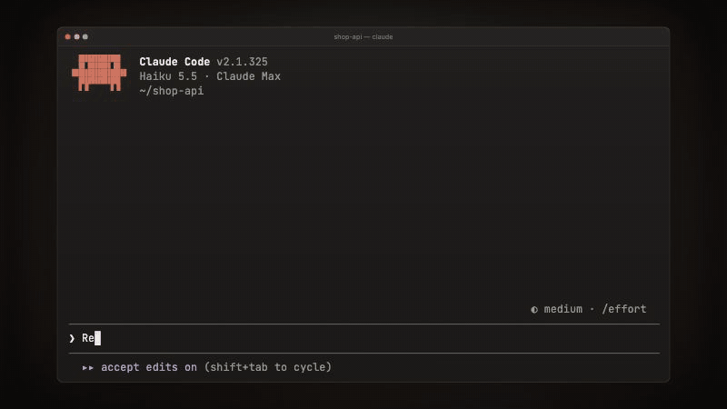

<!-- Generated by showcase/docs-gen from showcase/features/redact-tool-output/spec.yaml. Edit the spec, not this file. -->
# Redact secrets before Claude ever sees them

> **Claude Code v2.1.122** · hooks · [changelog](https://github.com/anthropics/claude-code/blob/main/CHANGELOG.md)

[](https://media.havoptic.com/showcase/claude-code-template/redact-tool-output/hero-16x9.mp4)

▶ **Watch the 35s film:** [MP4 1080p](https://media.havoptic.com/showcase/claude-code-template/redact-tool-output/hero-16x9.mp4) (10.3 MB) · [WebM](https://media.havoptic.com/showcase/claude-code-template/redact-tool-output/hero.webm) (4.8 MB) · [9:16](https://media.havoptic.com/showcase/claude-code-template/redact-tool-output/social-9x16.mp4) · [1:1](https://media.havoptic.com/showcase/claude-code-template/redact-tool-output/social-1x1.mp4) · [captions](https://media.havoptic.com/showcase/claude-code-template/redact-tool-output/captions.vtt)

<!-- Film files live in the R2 bucket behind https://media.havoptic.com/showcase/claude-code-template; upload them with:
     pnpm --dir showcase upload --slug redact-tool-output -->

**Your hook rewrites tool output. Secrets never reach the model.**

A `PostToolUse` hook receives every Bash, Read and Grep result before the model does. `redact-secrets.sh` scans it for secret-shaped strings (Anthropic, OpenAI-style, AWS, GitHub, Slack, JWT) and returns `hookSpecificOutput.updatedToolOutput`. The model, the transcript and anything it writes afterwards only ever see `[REDACTED-…]`.

## How to enable

In `.claude/settings.json`:

```json
{
  "hooks": {
    "PostToolUse": [{
      "matcher": "Bash|Read|Grep",
      "hooks": [{
        "type": "command",
        "command": "bash scripts/hooks/redact-secrets.sh"
      }]
    }]
  }
}
```

Or get it with the whole template:

```bash
claude plugin install dev-starter-kit@scotthavird-marketplace
```

## Try it in 60 seconds

1. Install the plugin, or copy `scripts/hooks/redact-secrets.sh` and the hook block above into your project.
2. Create a `.env` with a fake key, e.g. `OPENAI_API_KEY=sk-proj-FAKEdemoKEYnotREAL000000`.
3. Start `claude` and ask: `Read .env and list every key with its value`.
4. The secret comes back as `[REDACTED-openai-style-key]`; `NODE_ENV` and `PORT` come back unchanged.

## What you just watched

A transcript of the film (also shipped as `captions.vtt`). Every terminal frame is a real `claude` session, recorded by the showcase pipeline; sped-up sections are labelled on screen.

- **0:00** Your agent just read your .env.
- **0:02** API keys land in the transcript.
- **0:03** Then in logs. Then in a PR comment.
- **0:05** One PostToolUse hook stops it.
- **0:06** Redact Secrets. Your hook rewrites tool output. Secrets never reach the model.
- **0:12** Ask Claude to read a real .env file
- **0:13** Claude reads the file. The hook rewrites the result before the model sees it.
- **0:18** The key never reaches the model, the transcript or the reply.
- **0:21** Values that aren't secrets come back untouched.
- **0:26** One hook block in .claude/settings.json turns it on
- **0:30** Ship agents that can't leak what they never see. claude plugin install dev-starter-kit@scotthavird-marketplace

## Related

- [`scripts/hooks/redact-secrets.sh`](../../scripts/hooks/redact-secrets.sh)
- [`docs/hooks-cookbook.md`](../hooks-cookbook.md)
- [`.claude/settings.json`](../../.claude/settings.json)
- [Changelog](https://github.com/anthropics/claude-code/blob/main/CHANGELOG.md): "PostToolUse hooks can now replace tool output via updatedToolOutput"
- Film source: [`showcase/features/redact-tool-output/spec.yaml`](../../showcase/features/redact-tool-output/spec.yaml)
